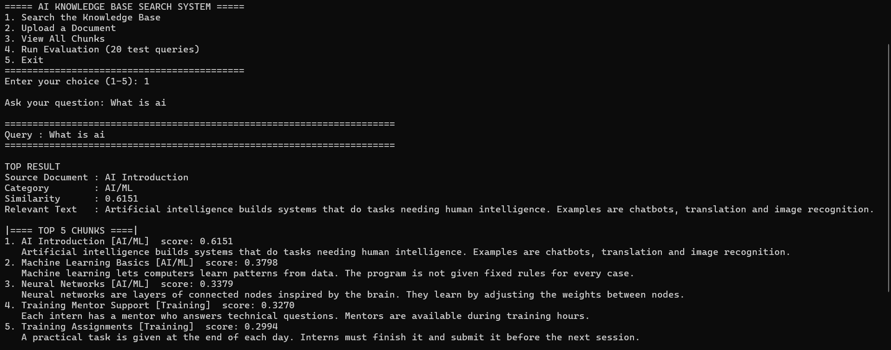
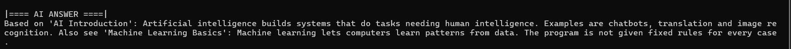
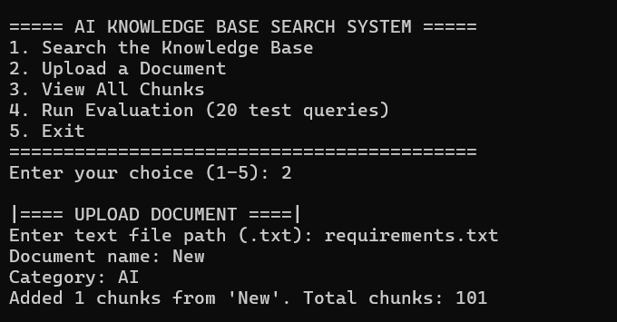
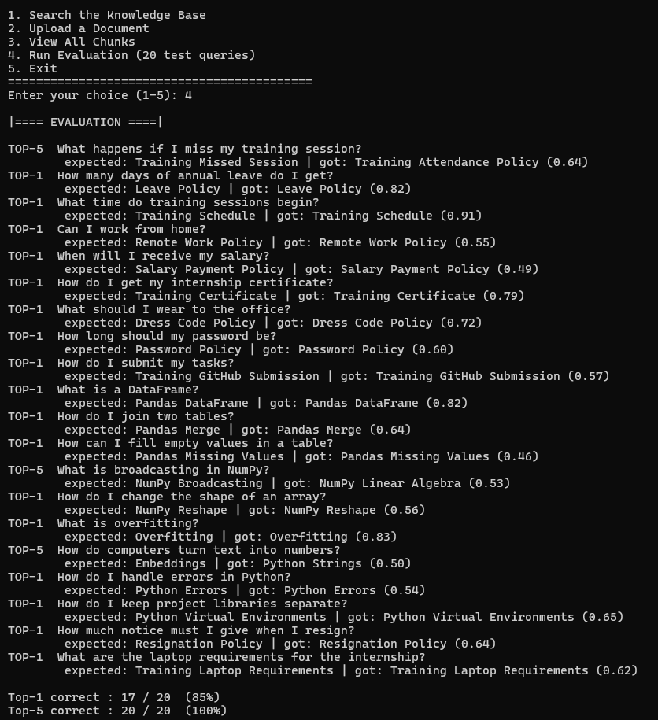

# AI Knowledge Base Search System

Semantic search over 100 documents (Python, AI/ML, NumPy, Pandas, company policies, training information).

## Architecture
Documents -> Clean -> Chunk -> Embed -> Store -> Query -> Query Embedding -> Similarity Search -> Top 5 -> Threshold -> Answer

- Cleaning: extra spaces and new lines removed
- Chunking: 2 sentences per chunk
- Embeddings: sentence-transformers all-MiniLM-L6-v2 (384 dimensions, normalized)
- Storage: chunks, categories, document names (lists) + embeddings (.npy), same index
- Search: dot product of normalized vectors = cosine similarity, np.argsort for ranking
- Answer: extractive answer from chunks above the similarity threshold

## Run
pip install -r requirements.txt
python knowledge_base.py

## Evaluation
20 test queries. Top-1: 17 / 20, Top-5: 20 / 20   (fill after running option 4)

## Screenshots

### Search Result

### AI Answer

### Document Upload

### Evaluation
